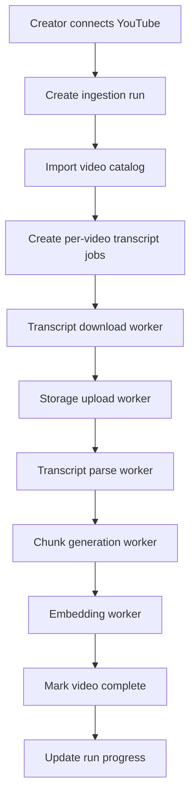

# Persona Backend Architecture

## Goal

Build a production-ready ingestion system for Persona that can process creator channels with 50, 500, or 5000 videos without becoming fragile, expensive, or impossible to maintain.

Persona is not a chatbot. It is a creator memory system.

That means the backend must optimize for:

- traceable ingestion
- resumable processing
- durable state
- observable progress
- easy reprocessing
- future feature expansion

---

## 1. Problems in the current implementation

The current code proves the pipeline works, but it has a few architectural limits:

- `app/api/youtube/ytdlp/saveVideosInDb/route.ts` mixes orchestration, database writes, yt-dlp execution, transcript download, and transcript processing in one request path.
- `app/worker/youtube/downloadAllTranscripts.ts` downloads one transcript and immediately uploads it, but job state is not modeled explicitly.
- `chunking/embedChunks.ts` both calls the embedding model and writes final rows, which makes retries and partial recovery harder.
- Background work currently depends on request execution. That is risky for long-running jobs.
- There is no durable queue abstraction.
- Per-video stage progress is not modeled cleanly.
- Recovery after partial failure is manual.

The redesign below separates **metadata**, **operational jobs**, **artifacts**, and **progress reporting**.

---

## 2. Recommended architecture

### Core decision

Use a **database-backed job queue** first, not Redis/Kafka/SQS on day one.

Why:

- easiest to build now inside your existing Next.js + Supabase stack
- durable by default
- simple to inspect in SQL
- resumable after crashes
- easy to expose progress to frontend
- can later be swapped behind the same worker interfaces

### High-level model

- **Metadata tables** store creators, videos, transcripts, chunks, embeddings, comments, etc.
- **Run tables** store one ingestion run per creator.
- **Task tables** store per-stage work items.
- **Workers** poll pending tasks with row locking.
- **Workers update status after every stage**.
- **Frontend reads aggregated progress from run tables and task counters**.

---

## 3. End-to-end pipeline



### Independent stages

1. **Catalog Import**
   - fetch all creator videos from YouTube
   - upsert video metadata
   - create a run-scoped processing record for each video

2. **Transcript Download**
   - yt-dlp downloads transcript JSON3
   - result stored temporarily on disk or streamed

3. **Transcript Storage Upload**
   - upload raw transcript to Supabase Storage
   - store storage path and checksum

4. **Transcript Parse**
   - parse JSON3 into normalized transcript segments
   - store segment metadata if needed

5. **Chunk Generation**
   - create semantic chunks with overlap
   - stage chunks for embedding

6. **Embedding Generation**
   - batch chunks per video or per job
   - call embedding model
   - write vectors to `video_chunks`

7. **Completion / Failure**
   - mark video stage complete
   - aggregate progress into run summary

Each stage is independent and idempotent.

---

## 4. Operational design

## 4.1 Two levels of state

### A. Business data

These represent the creator memory itself.

- `youtube_connections`
- `videos`
- `transcripts`
- `video_chunks`
- later: `comments`, `creator_replies`, `thumbnail_assets`, `content_metrics`

### B. Operational data

These represent ingestion execution.

- `ingestion_runs`
- `video_processing_states`
- `pipeline_tasks`
- `pipeline_task_attempts`
- `run_stage_counters`

This separation matters a lot.

If you mix execution state directly into core content tables, retries and reprocessing become messy.

---

## 4.2 Recommended tables

## `ingestion_runs`

One row per creator-triggered import run.

| column | type | notes |
|---|---|---|
| `id` | uuid | PK |
| `creator_id` | uuid | internal creator reference |
| `youtube_connection_id` | uuid | source account |
| `status` | text enum | `queued`, `running`, `paused`, `completed`, `failed`, `cancelled` |
| `requested_by` | text | clerk user id |
| `trigger_source` | text | `manual`, `scheduled`, `retry_failed`, `refresh` |
| `total_videos` | int | total discovered |
| `processed_videos` | int | completed videos |
| `failed_videos` | int | failed terminally |
| `active_videos` | int | currently processing |
| `stage` | text | overall dominant stage |
| `progress_percent` | numeric | computed summary |
| `started_at` | timestamptz | |
| `finished_at` | timestamptz | |
| `cancel_requested_at` | timestamptz nullable | |
| `pause_requested_at` | timestamptz nullable | |
| `error_summary` | jsonb | optional run-level summary |
| `created_at` | timestamptz | |
| `updated_at` | timestamptz | |

## `video_processing_states`

One row per `run x video`.

This is the most important operational table.

| column | type | notes |
|---|---|---|
| `id` | uuid | PK |
| `ingestion_run_id` | uuid | FK |
| `video_id` | uuid | FK to `videos` |
| `status` | text enum | current stage status |
| `stage` | text enum | current stage |
| `retry_count` | int | across all tasks or current stage |
| `last_error_code` | text | nullable |
| `last_error_message` | text | nullable |
| `transcript_downloaded_at` | timestamptz | nullable |
| `transcript_uploaded_at` | timestamptz | nullable |
| `parsed_at` | timestamptz | nullable |
| `chunked_at` | timestamptz | nullable |
| `embedded_at` | timestamptz | nullable |
| `completed_at` | timestamptz | nullable |
| `started_at` | timestamptz | nullable |
| `updated_at` | timestamptz | |

### Recommended stage enum

- `pending`
- `catalog_imported`
- `downloading_transcript`
- `uploading_transcript`
- `parsing_transcript`
- `chunking_transcript`
- `generating_embeddings`
- `completed`
- `failed`
- `cancelled`

### Recommended status enum

- `queued`
- `running`
- `completed`
- `failed_retryable`
- `failed_terminal`
- `paused`
- `cancelled`

## `pipeline_tasks`

One row per executable unit.

| column | type | notes |
|---|---|---|
| `id` | uuid | PK |
| `ingestion_run_id` | uuid | FK |
| `video_processing_state_id` | uuid | FK |
| `video_id` | uuid | FK |
| `task_type` | text enum | `catalog_import`, `download_transcript`, `upload_transcript`, `parse_transcript`, `chunk_transcript`, `generate_embeddings` |
| `status` | text enum | `queued`, `leased`, `running`, `completed`, `failed_retryable`, `failed_terminal`, `cancelled` |
| `priority` | int | default 100 |
| `attempt_count` | int | |
| `max_attempts` | int | stage-dependent |
| `lease_expires_at` | timestamptz | for crash recovery |
| `available_at` | timestamptz | backoff scheduling |
| `worker_id` | text | current worker |
| `payload` | jsonb | stage-specific metadata |
| `result` | jsonb | stage output |
| `last_error` | jsonb | code, message, details |
| `created_at` | timestamptz | |
| `updated_at` | timestamptz | |

## `pipeline_task_attempts`

Audit log per attempt.

| column | type | notes |
|---|---|---|
| `id` | uuid | PK |
| `pipeline_task_id` | uuid | FK |
| `attempt_number` | int | |
| `worker_id` | text | |
| `started_at` | timestamptz | |
| `finished_at` | timestamptz | |
| `status` | text | success or failed |
| `error_code` | text | nullable |
| `error_message` | text | nullable |
| `metrics` | jsonb | duration, tokens, bytes, etc |

## `run_stage_counters`

Fast progress reads for frontend.

| column | type | notes |
|---|---|---|
| `id` | uuid | PK |
| `ingestion_run_id` | uuid | FK |
| `stage` | text | |
| `queued_count` | int | |
| `running_count` | int | |
| `completed_count` | int | |
| `failed_count` | int | |
| `total_count` | int | |
| `updated_at` | timestamptz | |

---

## 5. Content tables

Keep your content schema close to what you already have, but normalize it a bit more.

## `videos`

| column | notes |
|---|---|
| `id` | internal UUID |
| `youtube_connection_id` | FK |
| `youtube_video_id` | unique per channel or globally unique |
| `channel_id` | denormalized for lookup |
| `title` | |
| `description` | nullable |
| `published_at` | |
| `duration_seconds` | nullable |
| `thumbnail_url` | nullable |
| `view_count` | nullable |
| `like_count` | nullable |
| `comment_count` | nullable |
| `default_language` | nullable |
| `privacy_status` | nullable |
| `last_synced_at` | |
| `ingestion_version` | integer for reprocessing strategy |

## `transcripts`

| column | notes |
|---|---|
| `id` | UUID |
| `video_id` | FK unique |
| `source` | `youtube_auto`, `youtube_manual`, future `whisper` |
| `language` | `en` etc |
| `storage_bucket` | |
| `storage_path` | |
| `checksum_sha256` | dedupe and integrity |
| `raw_event_count` | optional |
| `parsed_segment_count` | optional |
| `status` | `uploaded`, `parsed`, `failed` |
| `created_at` | |

## `video_chunks`

| column | notes |
|---|---|
| `id` | UUID |
| `video_id` | FK |
| `transcript_id` | FK |
| `chunk_index` | |
| `chunk_text` | |
| `start_ms` | |
| `end_ms` | |
| `word_count` | |
| `token_count` | useful for model tuning |
| `embedding_model` | e.g. `nomic-embed-text` |
| `embedding_dimensions` | |
| `embedding_version` | for re-embedding later |
| `embedding` | pgvector |
| `metadata` | jsonb, optional extra context |
| `created_at` | |

Recommended unique key:

- `(video_id, embedding_version, chunk_index)`

This makes re-embedding safe.

---

## 6. Worker model

## 6.1 Worker communication strategy

### Build now

Use **database polling with row leasing**.

Workers do this loop:

1. select next available task using `FOR UPDATE SKIP LOCKED`
2. mark it `leased` with `lease_expires_at = now + lease_duration`
3. execute task
4. write result or failure
5. enqueue next task if successful
6. renew lease for long-running tasks if needed

### Why this is the right tradeoff now

- no new infrastructure required
- durable resume after crashes
- supports multiple workers safely
- can run locally, on a VM, or in containers
- simple for hackathon and still valid later

### Future upgrade path

Later you can swap `pipeline_tasks` dispatcher to:

- Upstash Redis queues
- SQS
- Cloud Tasks
- Temporal

The worker contract stays the same.

---

## 6.2 Recommended worker types

### `catalog-import-worker`

- consumes `catalog_import` tasks
- fetches creator video list
- upserts `videos`
- creates one `download_transcript` task per video
- updates `total_videos`

Concurrency: **1-2** globally or per creator. This task is not the bottleneck.

### `transcript-download-worker`

- consumes `download_transcript`
- runs yt-dlp
- stores file locally in temp dir or memory stream
- creates `upload_transcript` task

Concurrency: **2-4 per machine**.

yt-dlp is network heavy and process heavy. Do not run 50 at once.

### `transcript-upload-worker`

- consumes `upload_transcript`
- uploads raw JSON3 to Supabase Storage
- stores transcript metadata and checksum
- creates `parse_transcript` task

Concurrency: **8-16**. Mostly network I/O.

### `transcript-parse-worker`

- consumes `parse_transcript`
- parses JSON3 into normalized segments
- validates transcript shape
- creates `chunk_transcript` task

Concurrency: **8-16**. Light CPU.

### `chunk-worker`

- consumes `chunk_transcript`
- generates chunks with overlap
- persists staged chunk rows or in-task payload
- creates `generate_embeddings` tasks

Concurrency: **6-12**.

### `embedding-worker`

- consumes `generate_embeddings`
- batches chunk text into embedding requests
- writes vectors to pgvector table
- marks video completed

Concurrency: **2-6**, depending on model throughput.

This is the bottleneck stage in most systems.

---

## 6.3 Per-creator fairness

Do not let one creator with 5000 videos starve everyone else.

Add these rules:

- cap active tasks per creator, for example `max 10 running videos per creator`
- give older queued runs higher priority
- keep stage-specific worker limits

This prevents a giant import from monopolizing the cluster.

---

## 7. Fault tolerance and resume behavior

## 7.1 Failure model

If video #357 fails, the run must continue for #358 onward.

That means:

- one failed video only changes its own `video_processing_states` row
- the `ingestion_run` continues unless failure rate crosses a threshold
- failed tasks are retried with backoff
- exhausted retries mark video as `failed_terminal`
- creator can later retry failed items only

## 7.2 Row leasing

If a worker dies mid-task:

- task lease expires
- another worker can reclaim it
- system resumes automatically

## 7.3 Idempotency

Every stage must be safe to run twice.

Examples:

- `videos` uses upsert on `youtube_video_id`
- `transcripts` uses upsert on `video_id`
- `video_chunks` uses unique key on `(video_id, embedding_version, chunk_index)`
- storage upload can overwrite same path if checksum matches
- creating next-stage task should use deterministic unique constraints to avoid duplicates

## 7.4 Retry strategy

Recommended defaults:

| stage | max attempts | retry pattern |
|---|---|---|
| catalog import | 3 | 30s, 2m, 5m |
| transcript download | 4 | 1m, 5m, 15m, 30m |
| upload | 4 | 30s, 2m, 5m, 10m |
| parse | 2 | immediate, 2m |
| chunk | 2 | immediate, 2m |
| embeddings | 5 | 1m, 5m, 15m, 30m, 60m |

Classify failures:

### Retryable

- transient network failure
- yt-dlp timeout
- storage upload timeout
- temporary embedding API failure
- Supabase transient connection issue

### Terminal

- transcript unavailable for a video
- malformed unsupported transcript after validation
- video deleted/private and inaccessible
- schema validation error due to bad persistent data

---

## 8. Progress reporting to frontend

## 8.1 What frontend needs

For each run, return:

- total videos
- queued videos
- processing videos
- completed videos
- failed videos
- current stage distribution
- percent complete
- estimated time remaining
- most recent failures

## 8.2 How to compute progress

### Run-level progress

Weighted progress is better than counting only completed videos.

Example weights:

- catalog import = 5%
- transcript download = 20%
- upload = 10%
- parse = 10%
- chunk = 15%
- embeddings = 40%

Then percent complete = average weighted stage completion across all videos.

This gives smoother UI than waiting for full completion per video.

## 8.3 ETA strategy

Store recent average durations per stage:

- avg transcript download time
- avg upload time
- avg parse time
- avg chunk time
- avg embed time per chunk or per 100 chunks

Then estimate:

`remaining queued work * moving average duration / active concurrency`

This is approximate, but good enough for the dashboard.

## 8.4 Progress endpoint response shape

```json
{
  "runId": "uuid",
  "status": "running",
  "totalVideos": 500,
  "processedVideos": 310,
  "failedVideos": 12,
  "activeVideos": 8,
  "progressPercent": 62.4,
  "etaSeconds": 5340,
  "stages": {
    "downloading_transcript": {
      "total": 500,
      "running": 4,
      "completed": 420,
      "failed": 8
    },
    "uploading_transcript": {
      "total": 500,
      "running": 2,
      "completed": 410,
      "failed": 3
    },
    "generating_embeddings": {
      "total": 500,
      "running": 2,
      "completed": 280,
      "failed": 1
    }
  },
  "recentFailures": [
    {
      "videoId": "uuid",
      "youtubeVideoId": "abc123",
      "stage": "download_transcript",
      "message": "Transcript not available"
    }
  ]
}
```

## 8.5 Realtime updates

### Build now

- frontend polls every 2-5 seconds via REST

### Optional better UX

- use Supabase Realtime on `ingestion_runs` and `run_stage_counters`

Polling is easier to ship now. Realtime can be added later without changing worker internals.

---

## 9. Embedding architecture

## 9.1 When embeddings should be generated

Generate embeddings **after chunking succeeds** and **before marking the video complete**.

Do not embed directly inside the parser or chunker.

Embedding is its own stage because:

- it is expensive
- it has different retry semantics
- it often has different throughput limits
- re-embedding is a common future need

## 9.2 Batching strategy

Recommended:

- chunk per video first
- send embedding requests in batches of **32-128 chunks**, based on token size and model throughput
- one task may produce multiple embedding sub-batches internally

For very large transcripts:

- chunk all text
- write staged chunks first
- embed in smaller pages

## 9.3 Retry strategy for embeddings

- retry on timeouts, 429s, 5xx, connection resets
- persist partial success only if batch writes are idempotent
- if half a batch succeeds, write successful rows and requeue only missing chunk indexes

## 9.4 Metadata stored with embeddings

Store this alongside every chunk vector:

- `video_id`
- `transcript_id`
- `youtube_video_id`
- `channel_id`
- `chunk_index`
- `start_ms`
- `end_ms`
- `embedding_model`
- `embedding_version`
- `language`
- optional future tags: `topic`, `speaker`, `source_type`

This will make future filtering much easier.

## 9.5 Re-embedding strategy

Support future model upgrades by versioning embeddings.

Do not overwrite old embeddings blindly.

Use:

- `embedding_model`
- `embedding_version`

Then queries can target the active version.

---

## 10. REST API design

Namespace these under `app/api/ingestion`.

## `POST /api/ingestion/runs`

Create and start a new ingestion run.

### Request

```json
{
  "youtubeConnectionId": "uuid",
  "mode": "full"
}
```

### Behavior

- validates creator ownership
- creates `ingestion_runs` row
- enqueues `catalog_import` task
- returns run id

---

## `GET /api/ingestion/runs/:runId`

Get detailed run status.

### Returns

- overall progress
- stage counters
- counts
- ETA
- failures summary

---

## `GET /api/ingestion/runs/:runId/videos`

Paginated video-level status.

### Query params

- `status`
- `stage`
- `page`
- `limit`

Useful for admin/debug screens.

---

## `POST /api/ingestion/runs/:runId/pause`

Pause run.

### Behavior

- marks `pause_requested_at`
- workers stop leasing new tasks for this run
- running tasks finish or stop at stage boundary

---

## `POST /api/ingestion/runs/:runId/resume`

Resume paused run.

### Behavior

- clears pause flag
- run status back to `running`
- queued tasks become leaseable again

---

## `POST /api/ingestion/runs/:runId/cancel`

Cancel run.

### Behavior

- marks `cancel_requested_at`
- workers stop creating downstream tasks
- queued tasks become `cancelled`
- running tasks exit at safe checkpoint when possible

---

## `POST /api/ingestion/runs/:runId/retry-failed`

Retry only failed videos/tasks.

### Behavior

- scans `video_processing_states` with terminal/retryable failures
- creates new tasks starting from failed stage
- preserves completed videos

---

## `POST /api/ingestion/videos/:videoId/reprocess`

Reprocess a single video.

### Request

```json
{
  "fromStage": "download_transcript"
}
```

### Behavior

Useful for debugging and manual repair.

---

## `GET /api/ingestion/runs/:runId/events`

Optional later SSE endpoint for progress streaming.

Build later if polling is not enough.

---

## 11. Folder structure for this Next.js repo

Recommended structure:

```text
replyai/
  app/
    api/
      ingestion/
        runs/
          route.ts
        runs/[runId]/route.ts
        runs/[runId]/pause/route.ts
        runs/[runId]/resume/route.ts
        runs/[runId]/cancel/route.ts
        runs/[runId]/retry-failed/route.ts
        runs/[runId]/videos/route.ts
        videos/[videoId]/reprocess/route.ts
      youtube/
        connect/
        callback/
        checkConnection/
    dashboard/
    onboarding/

  workers/
    runner.ts
    lease-task.ts
    heartbeat.ts
    stages/
      catalog-import.worker.ts
      transcript-download.worker.ts
      transcript-upload.worker.ts
      transcript-parse.worker.ts
      chunk.worker.ts
      embedding.worker.ts
    shared/
      task-context.ts
      backoff.ts
      task-result.ts

  services/
    ingestion/
      ingestion-orchestrator.ts
      progress-service.ts
      retry-service.ts
      eta-service.ts
    youtube/
      youtube-catalog.service.ts
      youtube-transcript.service.ts
    transcript/
      transcript-parser.service.ts
      transcript-chunker.service.ts
    embeddings/
      embedding.service.ts
    storage/
      transcript-storage.service.ts

  repositories/
    ingestion-run.repository.ts
    pipeline-task.repository.ts
    video-processing.repository.ts
    videos.repository.ts
    transcripts.repository.ts
    chunks.repository.ts

  lib/
    ai/
      deepseek.ts
      embeddings.ts
    db/
      supabase-admin.ts
      transaction.ts
    storage/
      supabase-storage.ts
    queue/
      db-queue.ts
    youtube/
      ytdlp.ts
    observability/
      logger.ts
      metrics.ts
      tracing.ts
    schemas/
      transcript.ts
      task-payloads.ts
    utils/
      time.ts
      checksum.ts
      chunking.ts

  types/
    ingestion.ts
    youtube.ts
    transcript.ts

  docs/
    persona-backend-architecture.md
```

### Important note

Create a **service-role Supabase client** for workers.

Do not use the cookie-based request client in `lib/supabase/server.ts` for background workers.

Add something like:

- `lib/db/supabase-admin.ts`

That client should use `SUPABASE_SERVICE_ROLE_KEY` and no user cookies.

---

## 12. Concurrency and scaling recommendations

## 12.1 Safe defaults for one machine

If running on one medium instance:

- catalog import: `1`
- transcript download: `3`
- transcript upload: `8`
- parse: `8`
- chunk: `6`
- embedding: `3`

## 12.2 Why these limits

### yt-dlp

- external process spawn
- network latency to YouTube
- can trigger throttling if too aggressive
- too much concurrency will hurt stability more than help

### Embeddings

- usually the slowest stage
- can saturate CPU, model server, or remote inference budget
- should be carefully batched and capped

### Supabase

- many tiny inserts are inefficient
- prefer batched writes where possible
- do not write one chunk row at a time if you can insert 50-200 together

## 12.3 Scaling to 5000 videos

At that size, the architecture remains the same.

What changes:

- more worker replicas
- stronger per-creator caps
- more aggressive batching for chunk inserts and embeddings
- scheduled refresh runs instead of giant ad hoc reruns

The key is that the queue and task state are already durable.

---

## 13. Bottlenecks and performance notes

## CPU

Mostly affected by:

- transcript parsing
- chunk generation
- embedding tokenization / model runtime

Moderate concern.

## Memory

Risk areas:

- loading huge transcript files into memory
- embedding too many chunks in one batch

Recommendation:

- stream or page large files where practical
- cap chunks per batch
- do not keep all videos for a creator in memory at once

## Disk

Risk areas:

- temporary transcript files from yt-dlp

Recommendation:

- use temp files only briefly
- delete immediately after upload
- optionally stream directly to storage later

## Network

Major factor:

- YouTube transcript fetches
- Supabase storage upload
- embedding API calls

## Supabase / Postgres

Risk areas:

- too many tiny updates
- repeated aggregate scans on large runs
- vector inserts without batching

Recommendation:

- batch writes
- maintain counters incrementally
- index heavily on `run_id`, `status`, `stage`, `available_at`

## Suggested indexes

- `pipeline_tasks(status, available_at, priority)`
- `pipeline_tasks(ingestion_run_id, status)`
- `video_processing_states(ingestion_run_id, stage, status)`
- `videos(youtube_connection_id, youtube_video_id)` unique
- `video_chunks(video_id, embedding_version, chunk_index)` unique
- pgvector index on `video_chunks.embedding`

---

## 14. Pause, resume, cancel semantics

## Pause

- stops leasing new tasks
- lets in-flight tasks finish
- best for safe maintenance

## Resume

- queued tasks become available again

## Cancel

- no new downstream tasks
- queued tasks marked cancelled
- running tasks stop at safe checkpoint if possible

Do not try to kill yt-dlp or model calls mid-flight unless you own the worker runtime carefully. Stage-boundary cancellation is safer.

---

## 15. Future expansion without refactor

This design supports future features by adding new task types and content tables.

### Comment embeddings

Add:

- `comments`
- `comment_chunks` or direct comment embeddings
- new tasks: `import_comments`, `embed_comments`

### Creator reply learning

Add:

- `creator_replies`
- `reply_style_examples`
- retrieval filters mixing transcript memory and past reply memory

### Thumbnail analysis

Add:

- `thumbnail_assets`
- `thumbnail_features`
- `thumbnail_embedding_tasks`

### Title analysis

Add:

- `video_performance_snapshots`
- strategy worker that computes title patterns

### Video summaries

Add:

- `video_summaries`
- `summary_generation` tasks after embedding or after transcript parse

### Knowledge graphs

Add:

- `entities`
- `entity_mentions`
- `entity_extraction` tasks after parse/chunk stage

The important part is that all of these plug into the same **run/task/worker** model.

---

## 16. Recommended implementation order

Ship this in phases.

### Phase 1

- create operational tables
- create service-role db client
- move current logic into stage services
- implement db-backed task leasing
- implement catalog import + transcript download + upload

### Phase 2

- implement parse + chunk + embedding workers
- implement run progress aggregation
- expose run status endpoint to dashboard

### Phase 3

- add pause/resume/retry-failed/cancel
- add failure classification and task attempts audit
- add ETA estimation

### Phase 4

- add comment ingestion
- add public persona creator-scoped retrieval
- add strategy jobs for content ideas and thumbnails

---

## 17. Final recommendation

If you want the shortest path to a strong hackathon demo **and** a backend that still makes sense after the hackathon, build this as:

- **Supabase-backed queue**
- **row-leased workers**
- **per-run and per-video operational state tables**
- **independent stage workers**
- **polling progress API first**
- **service-role background clients**
- **idempotent writes everywhere**

That gives you:

- no restart from video #1 when #357 fails
- safe retries
- resume after crashes
- real progress bars in the dashboard
- room to grow into comments, thumbnails, titles, summaries, and knowledge graphs

without needing a major rewrite later.
